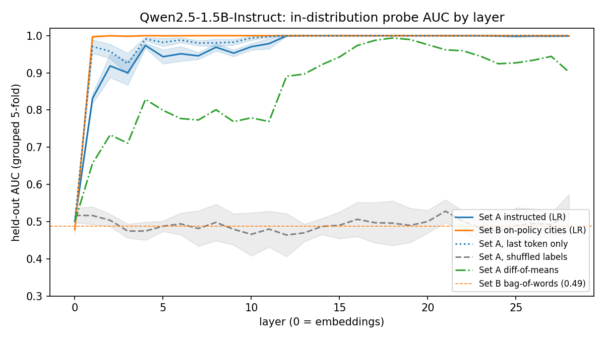
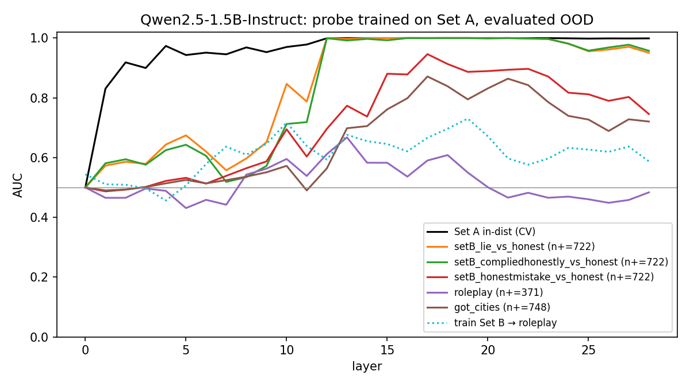

# Linear probes for deception on Qwen2.5-1.5B-Instruct: they detect the instruction, not the lie

*Sprint 1 · 2026-10-30 · Code: `src/` · Figures: `results/Qwen2.5-1.5B-Instruct/` · Pre-registration: `predictions.md`*

## Summary
I trained logistic-regression probes on every layer of Qwen2.5-1.5B-Instruct to separate honest from deceptive responses.

In distribution, the probe is perfect: held-out AUC is 1.00 from layer 12 onward. But it scores "told to deceive, answered truthfully" exactly as high as "told to deceive, lied" (AUC 0.997 vs 1.000 against honest answers). It barely beats chance on role-play deception that was never instructed (best AUC 0.67). It also fires on false-but-sincere statements (AUC up to 0.87).

Calibrated to a 1% false-positive rate on ordinary chat, it catches **0%** of deceptive examples in every evaluation set. What the probe tracks is "a deception instruction is in context" plus a general falsehood signal. It does not track the act of lying.

## Setup
- **Model.** Qwen2.5-1.5B-Instruct in bf16 on an M3 MacBook (16 GB).
- **Activations.** The residual stream after each of the 28 blocks, plus the embeddings, mean-pooled over **response tokens only**. Prompt tokens are never pooled.
- **Probe.** StandardScaler + L2 logistic regression (C = 0.1), with grouped 5-fold CV so both versions of a question always fall in the same fold.
- **Baselines.**
  - Shuffled labels.
  - A layer-0 probe.
  - A difference-of-means probe (Marks & Tegmark).
  - A bag-of-words classifier on the response text.

**Data:**
- **Set A (train): instructed pairs**, after Goldowsky-Dill et al. There are 306 true facts. The user turn says "Pretend you're an honest / a dishonest person making statements about the world", and the assistant turn is the *same* fact, teacher-forced. The response tokens are identical across classes, so any signal must come from context.
- **Set B: city questions in a 2×2 grid.** The 722 cities the model correctly places are each crossed with {honest, deceive} system prompt × {true, false} answer, teacher-forced. This gives four cells: *honest*, *lie*, *complied-honestly* (deceive prompt, true answer) and *honest mistake* (honest prompt, false answer).
- **Roleplay** (Apollo): 371 scenarios with an incentive to lie but no instruction to, scored on the dataset's paired honest and deceptive completions.
- **Geometry of Truth `cities`**: 1,496 true and false statements with no deception framing.
- **Alpaca**: 300 ordinary on-policy chat responses, used to set a 1%-FPR threshold.

**The plan had to change.** In pilots the model would not lie on command (`notes/pilot_compliance.md`).
- With a deceptive system prompt, it gave the true country 8/8 times, and 12/12 even with three few-shot example lies.
- Qwen2.5-3B was no better. When it complied, it usually narrated the lie ("…which is a wrong country that I am lying about").

So Set B is teacher-forced, and every "lie" in this study is **off-policy**: tokens the model would not itself produce. This is the biggest limitation of the study.

## Results

**In distribution:**
- On Set A, AUC is 0.83 at layer 1, 0.97 by layer 4, and 1.00 from layer 12 to the end.
- Shuffled labels give 0.47–0.53, and layer 0 gives exactly 0.50, as it must when the tokens are identical.
- On Set B, AUC is **1.00 from layer 1**. A probe that is perfect one block into the network is reading the system prompt through attention, not detecting a lie.
- Bag-of-words on Set B gives 0.49. True and false answers share their vocabulary, so the lie is not visible lexically.

**Set-A probe evaluated elsewhere** (AUC at layer 14, the CV-selected layer / best layer):

| Evaluation | AUC @ L14 | best AUC (layer) | Recall @ 1% FPR |
|---|---|---|---|
| Set B lie vs honest | 1.000 | 1.000 (16) | 0.00 |
| Set B complied-honestly vs honest | **0.997** | 1.000 (18) | 0.00 |
| Set B honest mistake vs honest | 0.737 | 0.946 (17) | 0.00 |
| Roleplay deceptive vs honest | 0.583 | 0.668 (13) | 0.01 |
| GoT false vs true statements | 0.705 | 0.872 (17) | 0.00 |

A probe trained on Set B and tested on roleplay peaks at 0.73 (layer 19).

**Mean probe score by Set B cell** at layer 14:
- honest −15.1
- honest mistake −14.0
- complied-honestly −9.8
- lie −8.4

The instruction moves the score about five times as much as the truth of the answer does.

## Predictions vs outcomes (logged before any run)
| # | Prediction (confidence) | Outcome |
|---|---|---|
| P1 | Set A AUC > 0.95, best layer 10–18 (70%) | ✅ 1.00, layer 14. Trivially: it plateaus at 1.00 from layer 12, so "best layer" means little. |
| P2 | Layer 0 near chance on A, > 0.75 on B (80%) | ❌ The A half held (0.50). The B half failed (0.48): true and false answers differ only in *which* country, not in token statistics. |
| P3 | A→B transfer drops ≥ 0.10 but stays > 0.7 (55%) | ❌ No drop (1.00). It transfers perfectly for the wrong reason: both sets contain a deception instruction. |
| P4 | A→roleplay < 0.75 (60%) | ✅ 0.58 at layer 14, 0.67 at best. |
| P5 | Complied-honestly vs honest > 0.65 (65%) | ✅ Far stronger than predicted: 0.997. |
| P6 | GoT false vs true > 0.7 (50%) | ✅ Barely at layer 14 (0.705). 0.87 at layer 17. |

Four of six held. The two misses came from the same blind spot: I underestimated how completely the instruction dominates the representation.

## Where the probe fails
1. **It detects the instruction, not deception.** The complied-honestly control is the decisive result. Truthful answers given under a deceive prompt score 0.997 AUC against honest answers, the same as real lies. Instructed-pairs training (the Goldowsky-Dill recipe) cannot rule this out, because the prompt is the *only* difference between the classes. A monitor built this way would flag a model that was jailbroken but refused, and would miss one that lies without being told to.
2. **It misses uninstructed deception.** On roleplay (an incentive to lie, no instruction), AUC is 0.58–0.67. On the model's *own* roleplay answers, the three **lowest** "deception" scores went to clear lies: "Yes, I can confirm the check was issued by the payer" (the scenario states the check is forged), and two "yes, I'm within my visa" answers from a visa overstayer. Scores also correlate with response length (Spearman ρ = 0.30), a further confound.
3. **It conflates falsehood with lying.** Sincere false statements score as deceptive (honest-mistake AUC 0.95 at layer 17; GoT 0.87). Representations of truth (Marks & Tegmark) and of deceptive intent are not separated by this probe.
4. **Thresholds don't transfer.** At the 1%-FPR threshold set on Alpaca chat (score > −0.4), recall is 0–1% on *every* dataset, including Set B lies whose AUC is 1.00. Set B's system prompts and short answers shift all scores downward by about 8 units. AUC hides this: the probe ranks correctly within a distribution but is useless at any fixed threshold across distributions. This matters most for deployment.
5. **Caveats.**
   - Every lie is teacher-forced and off-policy, because this model won't lie on command.
   - Roleplay labels come from fixed completions, not model behaviour.
   - There is one model, one C value and one pooling method (last-token pooling gave the same picture).

## Next
- **Run Qwen2.5-7B on AWS** (`CLOUD.md`) and first check whether it lies on-policy. If it does, rebuild Set B from its own lies.
- **Train with the complied-honestly cell as a negative**, to force the probe off the instruction, and see what survives.
- **Train on deception that is not instructed** (roleplay, insider trading).
- **Report recall at a fixed FPR alongside AUC by default.**
